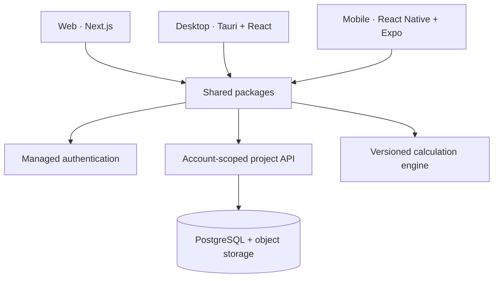

# Architecture

## Principle

The applications are presentation layers around one shared, deterministic TypeScript calculation engine. Formula logic must never be copied into individual apps.

## Boundaries

- `apps/*` may import `packages/*`.
- `packages/*` must not import from an application.
- `calc-core` contains pure functions and versioned schemas only; it cannot access UI, filesystem, network, or database APIs.
- Authentication tokens remain inside each platform's secure session adapter.
- Reports consume calculation-result objects; reports do not recalculate values.

## Data records

Every saved calculation records:

- project and account identifier
- module and calculation-engine version
- code family and edition
- input values with units
- assumptions and warnings
- result values with units
- governing checks and PASS/FAIL basis
- author, checker, date, and revision

## Offline direction

Limited cached offline sessions may be evaluated after the authenticated online workflow is secure. Offline access must not bypass account entitlement, project ownership, or audit history.
